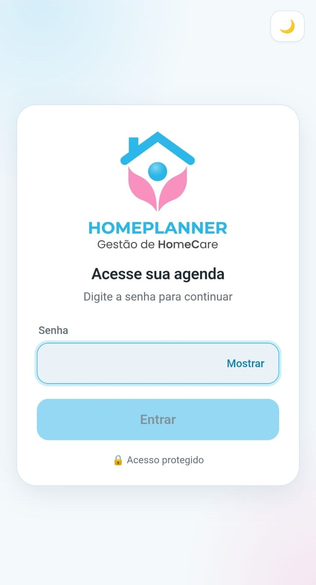
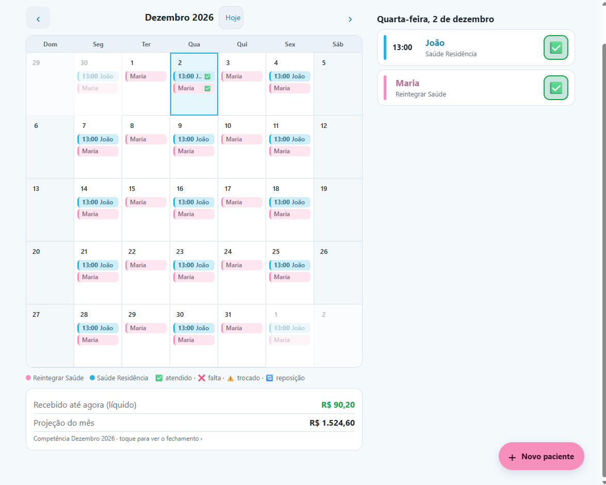
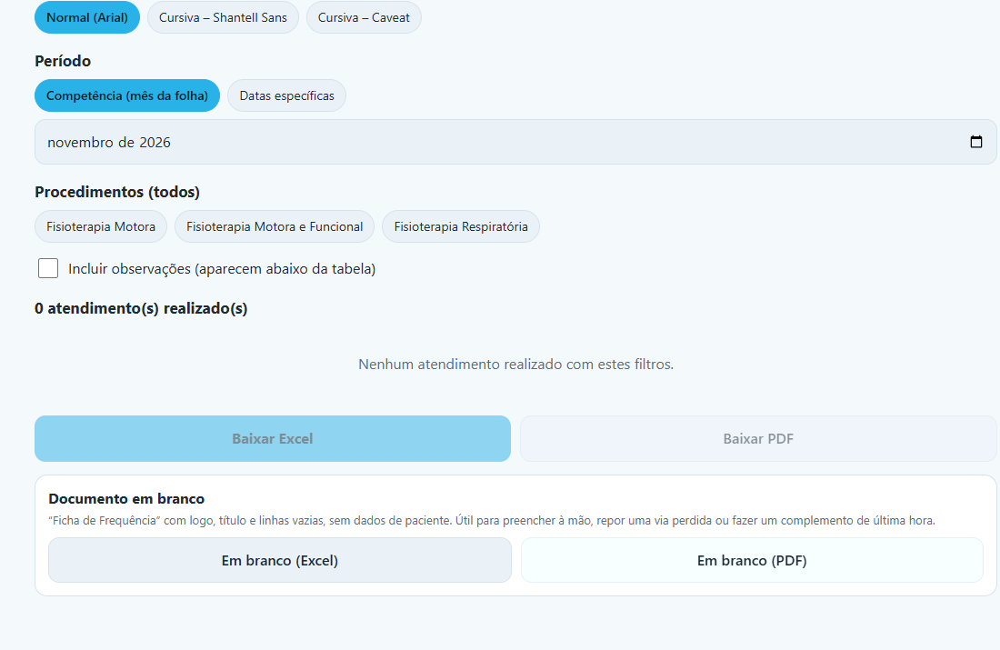
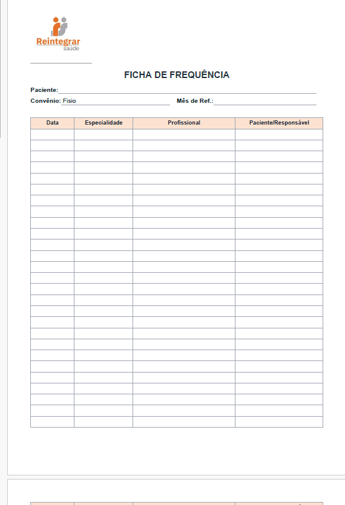
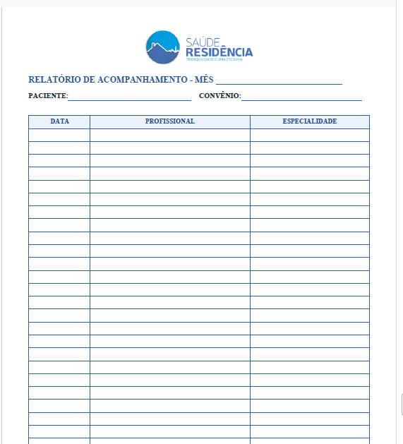

<p align="center">
  
</p>

<h1 align="center">HomePlanner</h1>

<p align="center">
  Agenda e controle de atendimentos de fisioterapia em homecare, de forma <b>prática, simples e organizada</b>.<br>
  PWA instalável no iPhone, funciona offline, tema claro e escuro.
</p>

<p align="center">
  <a href="https://atend-home-care.vercel.app"><b>atend-home-care.vercel.app</b></a>
</p>

---

## Para que serve

O HomePlanner ajuda a profissional de fisioterapia a **controlar os atendimentos dos pacientes em homecare e saber quanto vai receber**.
Ela cadastra o paciente uma vez (ex.: *segunda, quarta e sexta, às 13h*), e o app monta a agenda do mês, deixa marcar cada
atendimento como **realizado, falta ou troca** e **soma os valores** por empresa, já com descontos como o ISS.

No fim do mês, gera as **fichas de frequência e de evolução** no formato que cada empresa pede (Excel ou PDF).

> Os dados são de saúde. Por isso o app tem **login com senha**, e **nenhum dado de paciente fica neste repositório**.

## Abre direto no que importa

Você toca no ícone e **já cai na agenda do dia**, com o botão **Novo paciente** à mão. O mês fica a um toque, e cada
paciente aparece com a **cor da empresa** que presta o serviço, para bater o olho e saber de quem é.

## Telas

<table>
  <tr>
    <td align="center"><br><sub><b>Login</b> (celular)</sub></td>
    <td align="center"><br><sub><b>Mês</b> (computador)</sub></td>
    <td align="center"><br><sub><b>Evolução</b> e exportação</sub></td>
  </tr>
</table>

<table>
  <tr>
    <td align="center"><br><sub><b>Ficha de Frequência</b> em branco</sub></td>
    <td align="center"><br><sub><b>Relatório de Acompanhamento</b> em branco</sub></td>
  </tr>
</table>

## Funcionalidades

**Agenda**
- **Dia**, **Semana** e **Mês**. No computador, o mês mostra os nomes dentro de cada dia e a semana vira 7 colunas.
- Cada paciente com a **cor da empresa**. Empresas ilimitadas, cadastradas pelo próprio app.
- **Atendimento fixo** (dias da semana) ou **pontual** (datas avulsas). **Horário opcional**, usado só para ordenar o dia.
- **Situação do paciente** editável: ativo, internado, recusou tratamento, óbito, alta... Dá para adicionar e retirar. As que
  interrompem a agenda param de gerar atendimentos a partir da data informada.

**Marcar cada atendimento**
- ✅ **Atendido** · ❌ **Falta** (com motivo) · ⚠️ **Trocado de dia** (informa o dia da reposição) · 🔄 **Reposição**.
- A **reposição entra como atendimento normal** no dia em que acontece, e o dia trocado **não conta como falta**.
- **Não dá para marcar como atendido uma data futura.** Datas passadas e hoje podem.
- Se o paciente já tem atendimento no dia da reposição, o app **pergunta** antes de marcar 2 sessões no mesmo dia.
- Por atendimento: **evolução** (relato clínico), **observação** (ocorrências fora da sessão) e **competência** (mês da folha).

**Valores**
- **Procedimentos** com sigla e **preço por empresa**. Um atendimento pode ter vários procedimentos, somados.
- O valor é gravado **no momento em que o atendimento é marcado**: mudar o preço depois não altera o histórico.
- **Descontos por empresa** (ISS e outros), cada um com nome e percentual.
- **Fechamento do mês**: proventos, descontos e líquido por empresa, mais o **total geral**. Mostra também o **valor até agora**
  e a **projeção** do mês.
- **Dia de corte da folha** por empresa: atendimentos depois do dia entram na competência seguinte (ajustável um a um).

**Evolução e exportação**
- Filtros por **empresa, pacientes, período (competência ou datas), procedimentos e observações**, com tabela na tela.
- **Excel e PDF** no formato de cada empresa: Ficha de Frequência (Reintegrar), Relatório de Acompanhamento e Evolução Clínica
  (Saúde Residência), Frequência de atendimento (Interne) e uma tabela padrão.
- **Fichas editáveis pelo app**: título, campos, colunas, rodapé, cores, logo e linhas em branco. Empresa nova cria o modelo
  dela ali mesmo, sem depender de código.
- **Documento em branco** para preencher à mão, com o **mês escolhido, igual ao do período ou só a linha**.
- **Fonte da evolução** à escolha: Arial ou cursiva (Shantell Sans, Caveat).
- Nome do arquivo no padrão `EMPRESA_MES_ANO_PACIENTE_EVOLUCAO`.

**Geral**
- **Login com senha** (uma para a usuária, outra para o administrador) e **sincronização na nuvem**: abre no celular e no computador com os mesmos dados.
- **Funciona offline**: o que for feito sem internet é salvo no aparelho e enviado quando a conexão volta.
- **Tema claro e escuro** nas cores da logo. **Backup em JSON**; só o administrador restaura.

## O que foi usado e como

| Tecnologia | Como foi usada |
|---|---|
| **React 18** + **Vite 5** | Interface em componentes, sem biblioteca de rotas nem de estado: a navegação e os dados são simples e ficam em um único *store*. |
| **vite-plugin-pwa** (Workbox) | Torna o app instalável (ícone, tela cheia) e faz o cache para funcionar offline. |
| **Vercel** (Serverless Functions) | Hospeda o app e a API (`/api/login` e `/api/data`). |
| **MongoDB Atlas** (driver `mongodb` 6) | Guarda os dados: um documento `meta` (empresas, pacientes, preços...) e um documento por mês de atendimentos. |
| **ExcelJS** | Gera as planilhas `.xlsx` com cores, logo, bordas e linhas em branco, direto no navegador. |
| **jsPDF** + **jspdf-autotable** | Gera os PDFs, inclusive com a fonte cursiva embutida. |
| **localStorage** | Cópia local dos dados, que permite o uso offline e a escolha de tema/fonte. |
| **sharp** (só em um script de desenvolvimento) | Gera a logo com fundo transparente e os ícones do app a partir da logo original. O app em si não depende dele. |
| **Cookie assinado (HMAC) + `crypto`** | Sessão de 30 dias, sem biblioteca de autenticação. |

### Como funciona por dentro

- Cada paciente guarda a **regra de agenda** (dias da semana, datas pontuais, período). Os atendimentos de um dia são
  **calculados na hora**. O que é gravado são só os **registros** de dias que foram marcados (status, valor, evolução...).
- Trocar o dia gera um registro de **reposição** ligado ao dia original, e desfazer a troca remove a reposição pendente.
- Os valores do fechamento seguem a **competência**, e só entram atendimentos **marcados como realizados**.
- A sincronização envia **só o que mudou** (o `meta` e os meses alterados). Em conflito, vale a **última gravação**.

## Usar no celular ou no computador

Abra o endereço do app e entre com a senha.

**iPhone:** abra no **Safari** → **Compartilhar** → **Adicionar à Tela de Início**. Abre em tela cheia, com o ícone da logo.
**Android / computador (Chrome):** menu ⋮ → **Instalar app**.

> No iPhone, o PWA só instala pelo Safari. Para baixar planilhas e PDFs, o mais confortável é o computador.

## Rodar localmente

Requer **Node 20+**.

```bash
npm install
cp .env.example .env.local   # preencha as variáveis (veja abaixo)
npm run dev                  # http://localhost:5173
```

Em desenvolvimento, o próprio Vite serve as funções de `/api`, as mesmas que rodam na Vercel.

| Variável | Para quê |
|---|---|
| `MONGODB_URI` | String de conexão do MongoDB Atlas (usuário com permissão de leitura e escrita). |
| `MONGODB_DB` | Nome do banco. Use um diferente do de produção para testar (ex.: `homecare_dev`). |
| `USER_PASSWORD` | Senha de acesso da usuária. |
| `ADMIN_PASSWORD` | Senha do administrador (pode restaurar backup). |
| `SESSION_SECRET` | Texto aleatório longo, usado para assinar a sessão. |

```bash
npm run build   # gera a pasta dist
npm run brand   # (opcional) recria a logo transparente e os ícones a partir de assets-src/logo-original.jpg
```

## Publicar (Vercel + MongoDB Atlas)

1. No **Atlas**: crie um cluster gratuito, um usuário só para o app (leitura e escrita) e libere o acesso de rede `0.0.0.0/0`
   (a Vercel usa IPs variáveis; a proteção fica por conta do usuário e da senha).
2. Na **Vercel**: importe este repositório (preset **Vite**) e cadastre as 5 variáveis acima em *Environment Variables*.
3. Cada `git push` na `main` publica automaticamente.

## Segurança e privacidade

- **Dados de saúde**: nada de paciente vai para o repositório. Senhas e string de conexão ficam **só em variáveis de ambiente** (`.env.local` está no `.gitignore`).
- A sessão usa **cookie `HttpOnly`, `SameSite=Strict` e `Secure`** (em produção). A senha é comparada em tempo constante, e tentativas erradas esperam antes de responder.
- Só o administrador pode **substituir todos os dados** (restaurar backup).
- Sem rastreadores, sem anúncios e sem serviços de terceiros além de Vercel e MongoDB Atlas.
- Se uma senha ou a string de conexão vazar (chat, print...), **troque-a**: no Atlas em *Database Users*, e na Vercel em *Environment Variables* seguido de um novo deploy.

## Estrutura

```
api/
├── _lib.js        # conexão com o Mongo, sessão assinada, helpers
├── login.js       # entrar, sair e checar sessão
└── data.js        # ler e gravar os dados (meta + meses)
public/            # logos das empresas, ícones do app, fontes cursivas (licença OFL)
scripts/           # geração de ícones e da logo
src/
├── App.jsx        # navegação (abas, menu lateral no computador)
├── styles.css     # tema claro/escuro e layout responsivo
├── ui.jsx         # componentes comuns (folhas, balões, caixinha de status)
├── lib/
│   ├── core.js    # regras: agenda, status, reposição, competência, fechamento
│   ├── dates.js   # datas sem fuso horário ('AAAA-MM-DD')
│   ├── store.jsx  # dados locais + sincronização + sessão
│   ├── docs.js    # modelos das fichas (editáveis)
│   ├── exporter.js# geração de Excel e PDF
│   └── theme.js   # claro/escuro
└── screens/       # Calendar, Patients, StatusSheet, Closing, Evolution, DocEditor, Settings, Login
```

## Limitações

- **Uma profissional por instalação**: há duas senhas (usuária e administrador), mas todos veem os mesmos dados.
- **Conflitos**: se dois aparelhos alterarem a mesma coisa ao mesmo tempo, vale a última gravação.
- **Sem notificações push** de lembrete de atendimento.
- **Fonte cursiva no Excel**: o Excel só mostra a fonte se ela estiver instalada no computador (no PDF ela já vai embutida).
- **Sem testes automatizados no repositório**: a regra de agenda, de valores e a geração dos arquivos foram conferidas com roteiros de teste feitos à mão durante o desenvolvimento.
- A **primeira abertura** precisa de internet; depois, o app abre offline com o que já foi carregado.
